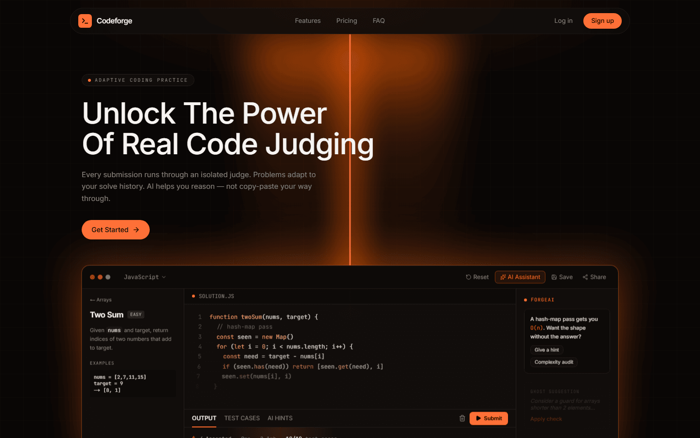
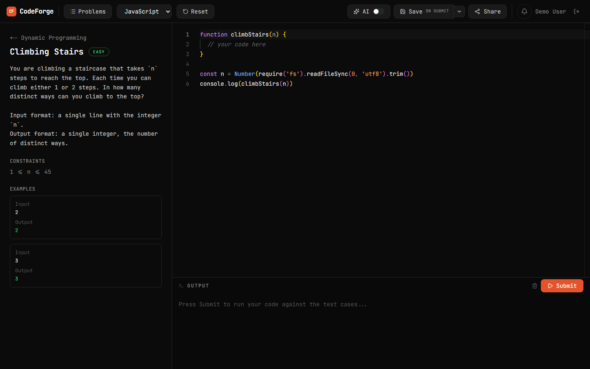
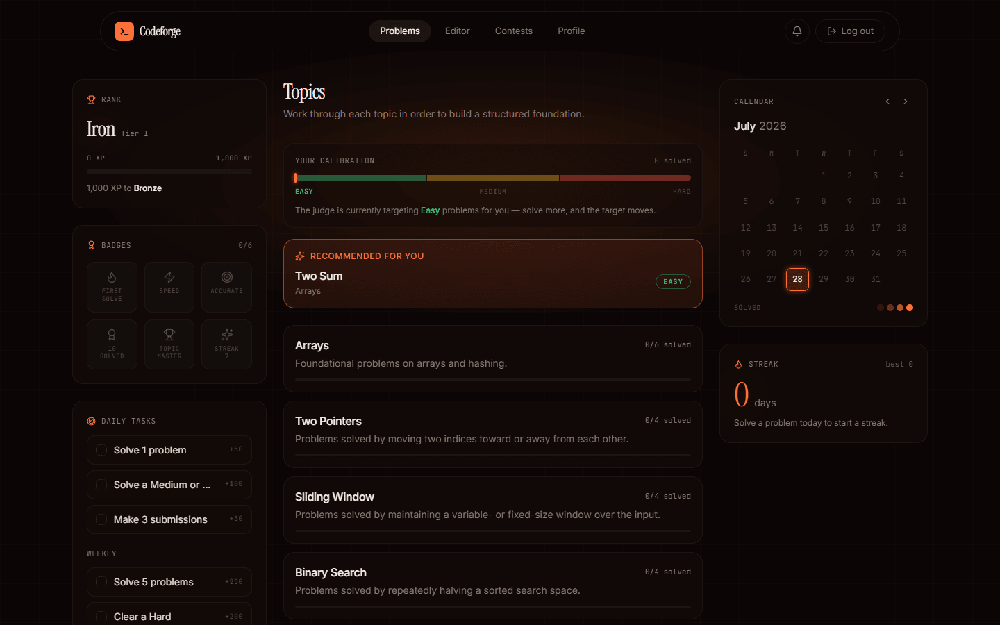
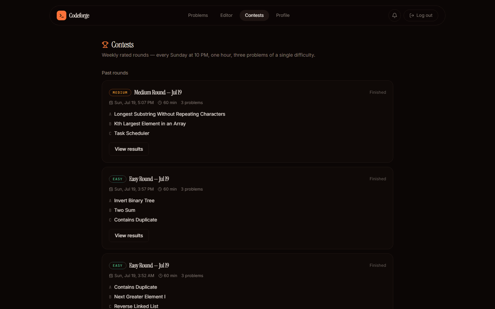

# CodeForge

A full-stack, self-hosted **DSA judge and learning platform**. Users solve data-structures & algorithms problems in an in-browser editor; submissions are compiled and run against hidden test cases inside a sandboxed execution engine, graded with per-test-case verdicts, and folded into an adaptive-difficulty and gamification system. A Socratic AI tutor helps learners *without* handing them the answer, weekly rated contests run ICPC-style scoring, and a full RBAC admin panel with an append-only audit log handles moderation.

> Not a LeetCode clone. CodeForge pairs the judge with a guardrailed AI tutor, an adaptive difficulty engine, rated contests, anti-cheat, and audited moderation — each an intentional, self-contained subsystem.

**🔗 Live app:** [codeforge-rust-xi.vercel.app](https://codeforge-rust-xi.vercel.app)

---

## Table of contents

- [Feature overview](#feature-overview)
- [Screenshots](#screenshots)
- [Architecture](#architecture)
- [Tech stack](#tech-stack)
- [The judge pipeline](#the-judge-pipeline)
- [Notable subsystems](#notable-subsystems)
- [Deployment](#deployment)
- [Getting started](#getting-started)
- [Code execution (Piston)](#code-execution-piston)
- [Environment variables](#environment-variables)
- [Admin & operational scripts](#admin--operational-scripts)
- [Project structure](#project-structure)

---

## Feature overview

**Solving & learning**
- Monaco-based code editor with multi-language support (JavaScript, Python, C++, Java).
- **100 problems across 15 topics** (35 easy / 45 medium / 20 hard), each with a statement, constraints, starter code, and sample + hidden test cases.
- **Sandboxed judging** against every test case, returning granular verdicts: `ACCEPTED`, `WRONG_ANSWER`, `RUNTIME_ERROR`, `TIME_LIMIT_EXCEEDED`, `COMPILE_ERROR`.
- **Hidden test cases never reach the browser.** The results API returns sample cases only; when every sample passes but a hidden case fails, the UI says so ("failed on a hidden test case") without revealing the case.
- **Socratic AI tutor** (streaming) that nudges with questions and concepts but is hard-guardrailed to never emit a full solution; it grows more concrete only after a few turns.
- **Adaptive difficulty** — a per-user skill score derived from solved difficulty and recent accuracy recommends the next problem's difficulty.

**Progression & competition**
- **Gamification**: XP by difficulty, tiered ranks (Iron → Master with divisions), daily/weekly claimable tasks, streaks, a solve calendar, and persisted badges — all derived from existing solve data.
- **Weekly rated contests**: an admin picks a difficulty; the system auto-selects three problems and schedules the round. Live arena with countdown, **ICPC-style scoring** (solves, then time + wrong-submission penalty), a live leaderboard, an "End Contest" early-finish flow, contest XP bonuses, and per-user result cards.

**Accounts & moderation**
- Auth via email/password (bcrypt) plus GitHub and Google OAuth, on a shared user row. Optional two-factor authentication: an emailed code or an authenticator app (TOTP), with backup codes.
- Self-service password reset with single-use, SHA-256-hashed, expiring tokens delivered over SMTP.
- **RBAC admin panel** with granular permissions: inspect users/submissions, ban/unban (permanent or timed, profile-locked), warn, revoke/restore submissions, review the anti-cheat queue, manage contests and admins.
- **Append-only audit log** recording every privileged state change.
- **Anti-cheat**: copy-poisoning of problem statements and per-problem canary tokens that flag suspected AI-pasted submissions for review (detect-and-discourage, never auto-punished). The contest arena's editor also blocks pasting and drag-and-drop of text, while copying code *out* still works.

**Platform**
- Responsive UI: mobile navigation menus, stacked editor/statement/output panels on small screens, scrollable tables, and drag-to-resize panels on desktop.
- Rate limiting on auth, 2FA, and email endpoints and on the scratchpad runner (with request-size caps).
- Security headers on every route (HSTS, `X-Frame-Options: DENY`, `nosniff`, `Referrer-Policy`, `Permissions-Policy`).
- Custom 404 and error pages, per-page titles and descriptions, and a generated link-preview image.

---

## Screenshots

**Landing page**


**Solving a problem** — Monaco editor, live test cases, AI tutor panel


**Topics dashboard** — rank, badges, daily/weekly tasks, adaptive calibration, streak, solve calendar


**Contests** — weekly rated rounds with ICPC-style scoring


---

## Architecture

```
                          Browser (Next.js App Router, React 19)
   Monaco editor · AI tutor panel · contest arena · admin panel · profile
                                     │
                                     │  fetch / server actions
                                     ▼
        ┌──────────────────────────────────────────────────────────┐
        │              Next.js server (Vercel, serverless)         │
        │                                                          │
        │   /api/execute ─ validate → enqueue submission (QUEUED)  │
        │   /api/run ───── scratchpad run (rate-limited, 64k cap)  │
        │   /api/ai ────── streaming Socratic tutor (guardrailed)  │
        │   /api/auth ──── NextAuth (JWT, 60s RBAC/ban re-read)    │
        │   admin/_actions ─ audited moderation server actions     │
        │                                                          │
        │   lib/  piston · gamification · adaptive · contest-score │
        │         ban · authz · anticheat · rate-limit · email     │
        └───────┬─────────────────────────┬─────────────────┬──────┘
                │                         │                 │
                ▼                         ▼                 ▼
        PostgreSQL (Neon)           External APIs      Piston sandbox
        via Prisma 7                Gemini · SMTP ·    Docker on an Azure VM,
        incl. the judge queue       OAuth · Upstash    behind nginx + API key,
                ▲                   Redis (limits)     runs untrusted code
                │                                             ▲
                └────── judge worker (npm run judge) ─────────┘
                        claims queued jobs, calls Piston
```

The judge, tutor, and moderation flows are deliberately isolated. Business logic in `src/lib` is written as **pure functions over already-fetched data** (scoring, skill, rank, ban-state) so it can be reasoned about — and unit-tested — without a database.

Only two things ever talk to Piston: the **judge worker** (over `localhost` on the VM that hosts Piston) and the scratchpad's **`/api/run`** (over HTTPS from Vercel, authenticated with the API key). The web request that submits a solution never runs code.

---

## Tech stack

| Layer | Choice |
|---|---|
| Framework | Next.js 16 (App Router) · React 19 · TypeScript |
| Styling / UI | Tailwind CSS v4 · shadcn/base-ui · lucide-react · Motion |
| State | Zustand |
| Editor | Monaco (`@monaco-editor/react`), lazy-loaded |
| Auth | NextAuth v5 (JWT) — Credentials + GitHub + Google, optional 2FA |
| Database | PostgreSQL (Neon) via Prisma 7 (Neon serverless adapter) |
| Code execution | Self-hosted [Piston](https://github.com/engineer-man/piston) in Docker on an Azure VM, behind nginx (HTTPS + API key) |
| AI | Google Gemini via the Vercel AI SDK (streaming) |
| Email | Nodemailer (Gmail SMTP) |
| Rate limiting | [Upstash](https://upstash.com) Redis (`@upstash/ratelimit`) — falls back to an in-memory limiter locally and if Upstash is unreachable |
| Hosting | Vercel (app) · Neon (database) · Azure VM (Piston sandbox + judge worker) |
| Tests | Vitest unit tests for the DB-free pure functions |

---

## The judge pipeline

Judging is **asynchronous**: the web request never runs code. Submissions go on a Postgres-backed queue and a standalone worker process judges them, so the API stays fast, Piston load is bounded, and transient sandbox failures retry instead of being recorded as wrong answers.

```
POST /api/execute ──► validate ──► INSERT submission {status: QUEUED} ──► return { submissionId }
                                                │
        judge worker (npm run judge) ◄──────────┘  claims oldest QUEUED via
        FOR UPDATE SKIP LOCKED, N lanes in parallel (JUDGE_CONCURRENCY)
                                                │
        runs test cases through Piston ─► writes verdict + status: DONE
                                                │
client polls GET /api/submissions/[id] ◄────────┘  until DONE / ERROR, renders result
```

**Enqueue** (`POST /api/execute`, `src/app/api/execute/route.ts`):
1. **Auth & ban gate** — ban state is re-read from the DB (not the up-to-60s-stale JWT) so a just-issued ban blocks the next submit; an expired timed ban is a no-op.
2. **Contest validation** (if `contestId` present) — the round must be live and actually contain the problem, so a stale/forged id can't attribute a solve.
3. **Enqueue** — the `Submission` is created `QUEUED` / `PENDING` with the canary flag; `createdAt` is stamped here and is the official submit time the contest leaderboard's penalty/timing math keys off, so judging a beat later stays fair. Returns `{ submissionId }` immediately.

**Worker** (`npm run judge`, `scripts/judge-worker.mts` → `src/lib/queue.ts` + `src/lib/judge.ts`):
4. **Claim** — `claimNextJob` atomically flips the oldest `QUEUED` row to `RUNNING` with `FOR UPDATE SKIP LOCKED` (a single statement, safe on the Neon HTTP adapter). `JUDGE_CONCURRENCY` lanes claim distinct rows, which is the backpressure/concurrency limit.
5. **Per-test-case execution** — each test case's input is piped as stdin to the code in Piston (`compile_timeout` 10s, `run_timeout` 5s); `SIGKILL` → TLE, non-zero compile → CE, non-zero run → RE, mismatch → WA. First failure short-circuits. Piston must be configured to allow these limits (`PISTON_RUN_TIMEOUT=5000`, `PISTON_COMPILE_TIMEOUT=10000`) — its default run limit is 3 s, and a request above the configured limit is rejected with a 400.
6. **Persistence & side effects** — verdict + per-test results + runtime are written with `status: DONE`; `UserProgress` is updated; badges are synced. A **transient** Piston failure re-queues the job (up to `MAX_ATTEMPTS`) and only then becomes a terminal `ERROR` — distinct from a `WRONG_ANSWER`, so infra hiccups never count against the user. A worker killed mid-judge leaves the row `RUNNING`; a stale-sweeper (`JUDGE_STALE_MS`) returns it to the queue.

The client (`OutputPanel`, `ContestArena`) enqueues then polls `GET /api/submissions/[id]` via `src/lib/poll.ts`, showing *Queued… / Judging…* until a terminal state. That endpoint is owner-scoped and returns **only the sample test results**, so hidden test inputs and expected outputs are never sent to the browser even though the worker stores them.

> **Scaling note:** this is the classic "design an online judge" shape. The Postgres queue swaps cleanly for Redis+BullMQ or SQS at scale; the worker is already horizontally scalable (multiple processes claim safely via `SKIP LOCKED`).
>
> **Deploy note:** the Next.js app is serverless-friendly (Vercel), but `npm run judge` is a long-lived process and won't run on Vercel's request-scoped functions. Run it on an always-on machine pointed at the same `DATABASE_URL` — in this project, the same VM that hosts Piston, kept alive with pm2 (see [Production](#production-piston-on-an-azure-vm)). No worker running ⇒ submissions stay `QUEUED` forever.

---

## Notable subsystems

- **`lib/contest-score.ts`** — ICPC scoring as pure functions: a problem is solved on first `ACCEPTED`; ranking is (solved DESC, penalty ASC); penalty = minutes-to-solve + 5 min per earlier wrong attempt on solved problems only. Includes contest XP (participation + rank bonus + per-solve multiplier).
- **`lib/adaptive.ts`** — DB-free skill computation: weighted average of solved difficulties, nudged by recent accuracy, mapped to a target difficulty.
- **`lib/gamification.ts`** — rank tiers, XP, streaks, solve calendar, and daily/weekly tasks, all *derived* from submissions + progress so no extra schema is needed.
- **`lib/ban.ts`** — single source of truth for "is this ban currently active", supporting permanent and timed, reversible bans.
- **`lib/anticheat.ts`** — HMAC-derived per-problem canary tokens + statement copy-poisoning.
- **`lib/rate-limit.ts`** — fixed-window limiter on the auth, 2FA, and email endpoints and on the scratchpad runner `/api/run` (which also caps code and stdin at 64,000 characters). Backed by Upstash Redis (one atomic script, correct across every serverless instance) when configured; falls back to an in-process `Map` when Redis isn't configured or can't be reached, so local dev needs no external account and an Upstash outage doesn't take endpoints down.
- **`lib/authz.ts` + `admin/_actions`** — permission checks enforced server-side on every admin action, each writing an `AuditLog` row.
- **`lib/site.ts`** — single source of truth for site identity (name, URL, contact email, GitHub) used by metadata, the footer, and the link-preview image.

---

## Deployment

**Live:** [codeforge-rust-xi.vercel.app](https://codeforge-rust-xi.vercel.app), deployed straight from this repo's `main` branch.

| Piece | Where |
|---|---|
| Next.js app | [Vercel](https://vercel.com) — serverless, deploys on every push |
| Database | [Neon](https://neon.tech) Postgres, via the Prisma 7 Neon serverless adapter |
| Auth | NextAuth v5 — credentials + GitHub + Google OAuth, both wired to the live domain |
| AI tutor | Google Gemini via the Vercel AI SDK |
| Rate limiting | [Upstash](https://upstash.com) Redis — real cross-instance limit, verified against the live deployment |
| Code execution | Piston in Docker on an **Azure VM** (Ubuntu 22.04). Only nginx is public: it terminates HTTPS (Let's Encrypt, on a free DuckDNS hostname) and requires an `X-API-Key` header. Piston itself listens on `127.0.0.1` only. |
| Judge worker | `npm run judge`, a long-lived process kept alive with pm2 on the same VM, so it reaches Piston over `localhost` |

Piston is deliberately **not** on Vercel (see [The judge pipeline](#the-judge-pipeline) and its **Deploy note**). The web app and the sandboxed execution engine are two different kinds of workload with two different hosting needs: Vercel functions are short-lived and request-scoped, while Piston is a long-running Docker sandbox that needs a **privileged container** — something Vercel, and most managed container platforms, don't allow. The async, queue-based pipeline exists specifically so the two can scale and fail independently of each other.

Vercel needs two variables to reach it (used by the scratchpad's `/api/run`): `PISTON_URL=https://<piston-host>/api/v2` and `PISTON_API_KEY`. Step-by-step setup is in [Production: Piston on an Azure VM](#production-piston-on-an-azure-vm).

---

## Getting started

### Prerequisites
- Node.js 20+
- A PostgreSQL database (a [Neon](https://neon.tech) connection string works out of the box)
- Docker Desktop (for the Piston execution sandbox)

### Setup

```bash
# 1. Install dependencies
npm install

# 2. Configure environment (see "Environment variables" below)
cp .env.example .env
#   then fill in the values

# 3. Apply the schema and seed problems
npx prisma migrate deploy
npx prisma db seed

# 4. Start the execution sandbox (see "Code execution" for details)
npm run piston:up
npm run piston:setup

# 5. Run the app + judge worker (separate terminals)
npm run dev          # terminal A — Next.js
npm run judge        # terminal B — standalone judge worker (see "The judge pipeline")
```

Open [http://localhost:3000](http://localhost:3000).

> The judge worker is a **separate long-running process** — submissions sit `QUEUED` and never get a verdict without it. See [The judge pipeline](#the-judge-pipeline).

To grant yourself admin access, sign in once, add your email to `ADMIN_EMAILS` in `.env`, then run `npm run admin:bootstrap`.

Before pushing, run the checks: `npm run typecheck`, `npm test`, and `npm run lint`.

---

## Code execution (Piston)

CodeForge runs submitted code through [Piston](https://github.com/engineer-man/piston), a sandboxed execution engine, via `src/lib/piston.ts`. For local development you self-host it with Docker rather than depending on the public `emkc.org` API (rate-limited and not meant for production judging traffic). In production the same container runs on a VM — see [Production](#production-piston-on-an-azure-vm) below.

### 1. Start the Piston container

Requires Docker Desktop with Linux containers (the image needs privileged mode for its sandboxing).

```bash
npm run piston:up      # brings up docker-compose.piston.yml on http://localhost:2000
npm run piston:logs    # follow status
```

### 2. Install language runtimes

A fresh Piston container has no language packages. Install the runtimes CodeForge expects (JavaScript, Python, C++, Java — kept in sync with `RUNTIME_MAP` in `src/lib/piston.ts`: Node 18.15.0, Python 3.10.0, gcc 10.2.0, Java 15.0.2):

```bash
npm run piston:setup
```

This polls until the container is ready, then installs any missing packages. Safe to re-run — it skips packages already installed.

### 3. Point the app at it

In `.env` (already the default if unset, so only needed for a remote/shared instance):

```
PISTON_URL=http://localhost:2000/api/v2
# Only for a remote instance behind a key-checking proxy:
# PISTON_API_KEY=...
```

When `PISTON_API_KEY` is set, `src/lib/piston.ts` (and `scripts/setup-piston.mjs`) send it as an `X-API-Key` header.

### Shutting it down

```bash
npm run piston:down
```

Installed packages persist in a named Docker volume (`piston-packages`), so they survive across restarts.

### Production: Piston on an Azure VM

This is how the live deployment runs. Any VM you have root on works the same way — the only hard requirement is a host that allows a **privileged** Docker container.

**1. Create the VM and lock down the network.** Ubuntu 22.04. In the cloud network rules (Azure: the network security group), allow inbound TCP **22, 80 and 443 only**. Never open port 2000 — Piston has no authentication of its own.

**2. Install Docker and start Piston.** Bound to loopback, with a volume so installed runtimes survive a container recreate, and with run/compile limits that match what the backend requests:

```bash
curl -fsSL https://get.docker.com | sudo sh
docker run -d --privileged --name piston_api --restart unless-stopped \
  -p 127.0.0.1:2000:2000 -v piston_data:/piston \
  -e PISTON_RUN_TIMEOUT=5000 -e PISTON_COMPILE_TIMEOUT=10000 \
  ghcr.io/engineer-man/piston
```

**3. Install the pinned runtimes.** Do this on the VM against `localhost`, not through nginx — a package install can take longer than nginx's 60 s proxy timeout:

```bash
for p in node:18.15.0 python:3.10.0 gcc:10.2.0 java:15.0.2; do
  curl -s -X POST localhost:2000/api/v2/packages -H 'Content-Type: application/json' \
    -d "{\"language\":\"${p%%:*}\",\"version\":\"${p##*:}\"}"; echo
done
curl -s localhost:2000/api/v2/runtimes    # confirm JavaScript, Python, C++, Java are listed
```

**4. Put nginx in front, with an API key and HTTPS.** Generate a key with `openssl rand -hex 32`, point a hostname (for example a free [DuckDNS](https://www.duckdns.org) subdomain) at the VM's public IP, then follow the numbered steps at the top of [`deploy/piston-nginx.conf`](deploy/piston-nginx.conf). It rejects any request without the matching `X-API-Key` header, and `certbot --nginx` adds a Let's Encrypt certificate that renews automatically.

**5. Smoke-test from anywhere.** Without the key you should get `401`; with it, the runtime list:

```bash
curl -i  https://<piston-host>/api/v2/runtimes
curl -s -H "X-API-Key: $PISTON_API_KEY" https://<piston-host>/api/v2/runtimes
```

**6. Configure Vercel.** Add `PISTON_URL=https://<piston-host>/api/v2` and `PISTON_API_KEY=<the key>` to the project's environment variables and redeploy. This is what the scratchpad's `/api/run` uses.

**7. Run the judge worker on the VM.** It needs only the database connection string — it reaches Piston at the default `http://localhost:2000/api/v2` and needs no API key:

```bash
git clone https://github.com/OmegaZeroG/ai-powered-codeforge.git && cd ai-powered-codeforge
echo 'DATABASE_URL=<your Neon connection string>' > .env && chmod 600 .env
npm ci
sudo npm install -g pm2
pm2 start npm --name judge-worker -- run judge
pm2 startup      # run the command it prints, then:
pm2 save
```

Update later with `git pull && npm ci && pm2 restart judge-worker`. Check it with `pm2 status` and `pm2 logs judge-worker`.

---

## Environment variables

Copy `.env.example` to `.env` and fill in:

| Variable | Purpose |
|---|---|
| `DATABASE_URL` | PostgreSQL / Neon **pooled** connection string, used by the app at runtime |
| `DIRECT_URL` | Unpooled Neon connection string, used only by `prisma migrate` / `db push` (falls back to `DATABASE_URL`) |
| `NEXTAUTH_SECRET` | NextAuth JWT signing secret |
| `NEXTAUTH_URL` | App base URL (`http://localhost:3000` in dev, the live domain in production) |
| `PISTON_URL` | Piston API base. Defaults to local Docker (`http://localhost:2000/api/v2`); in production `https://<piston-host>/api/v2` |
| `PISTON_API_KEY` | Key for a production Piston instance behind a key-checking reverse proxy, sent as an `X-API-Key` header (unset for local dev and for the worker on the Piston VM) |
| `JUDGE_CONCURRENCY` | Judge worker lanes — how many submissions it judges in parallel (default `4`) |
| `JUDGE_STALE_MS` | How long a job may sit in `RUNNING` before the sweeper re-queues it (default `120000`) |
| `JUDGE_IDLE_MS` | How long a worker lane sleeps when the queue is empty (default `500`) |
| `ANTICHEAT_SECRET` | Secret used to derive per-problem canary tokens (falls back to a fixed dev value if unset — set a real one outside local dev) |
| `GOOGLE_GENERATIVE_AI_API_KEY` | Gemini key for the AI tutor ([free tier](https://aistudio.google.com/apikey)) |
| `GITHUB_CLIENT_ID` / `GITHUB_CLIENT_SECRET` | GitHub OAuth (optional) |
| `GOOGLE_CLIENT_ID` / `GOOGLE_CLIENT_SECRET` | Google OAuth (optional) |
| `ADMIN_EMAILS` | Comma-separated emails granted full admin by `admin:bootstrap` |
| `SMTP_USER` / `SMTP_PASS` / `EMAIL_FROM` | Gmail SMTP for password-reset and verification email (in dev, unset → links are logged to the console) |
| `UPSTASH_REDIS_REST_URL` / `UPSTASH_REDIS_REST_TOKEN` | [Upstash](https://upstash.com) Redis (free tier) backing the rate limiter (`src/lib/rate-limit.ts`) with a real cross-instance limit; unset → falls back to an in-memory, per-instance limiter |
| `NEXT_PUBLIC_SITE_URL` | Public site URL used for link previews (defaults to the live domain) |
| `NEXT_PUBLIC_CONTACT_EMAIL` | Contact address shown in the footer |

The **judge worker** only needs `DATABASE_URL` (plus the optional `JUDGE_*` tuning variables); when it runs on the same machine as Piston it uses the default `PISTON_URL` and no API key.

---

## Admin & operational scripts

| Script | What it does |
|---|---|
| `npm run admin:bootstrap` | Grant full permissions to the emails in `ADMIN_EMAILS` (users must have signed in once) |
| `npm run admin:whoami` | Show the current admin(s) and their permissions |
| `npm run admin:reset-password` | Reset a user's password from the CLI |
| `npm run admin:check-password` | Verify a password hash |
| `npm run piston:up` / `:down` / `:logs` / `:setup` | Manage the local Piston sandbox. `piston:setup` also works against a remote instance when `PISTON_URL` and `PISTON_API_KEY` are set (`node --env-file=.env scripts/setup-piston.mjs`), but long installs can exceed a proxy's timeout — for a VM, install on the VM itself (see Production) |
| `npm run judge` | Start the standalone judge worker (claims `QUEUED` submissions and judges them). Required for any verdict to appear; run it alongside `npm run dev`. Honors `JUDGE_CONCURRENCY`, `JUDGE_STALE_MS`, and `JUDGE_IDLE_MS`. |
| `npm run judge:backfill` | One-time after adopting the async pipeline: marks already-judged historical submissions `DONE` so the worker doesn't re-judge them. Run once after `prisma db push` / `migrate`, before the worker. Idempotent. |
| `npm run typecheck` / `npm test` / `npm run lint` | TypeScript check, Vitest unit tests, ESLint |
| `npm run list-problems` | Print recent problems' id, slug, and title (handy for picking a `PROBLEM_ID` for the load test) |
| `npm run dev:verify-email` | Mark a throwaway **test** account's email as verified directly in the DB. Local dev only — never point it at a real user |
| `npm run load-test` | Judge-queue load test: fires bursts of concurrent submissions at `POST /api/execute`, polls to completion, and reports throughput and latency per concurrency level. Needs a running stack and a test account (see the script header) |
| `npm run security-check` | Scripted proof of security properties (rate limits, cookie flags, optional 2FA-bypass resistance) against a running dev stack. Needs test accounts (see the script header) |

---

## Project structure

```
src/
├── app/
│   ├── api/            # route handlers: execute (enqueue), run (scratchpad), ai (tutor), auth, signup, ...
│   ├── admin/          # RBAC admin panel + audited server actions (_actions)
│   ├── contests/       # contest list, live arena, history (each with a loading.tsx skeleton)
│   ├── problems/       # problem solving pages (resizable panels, loading.tsx skeleton)
│   ├── topics/         # topic browse (loading.tsx skeleton)
│   ├── profile/        # profile + gamification (loading.tsx skeleton)
│   ├── editor/         # standalone editor/scratchpad
│   ├── not-found.tsx, error.tsx, global-error.tsx   # 404 and error pages
│   └── robots.ts, opengraph-image.tsx               # robots.txt and the link-preview image
├── components/
│   ├── ui/             # generic primitives (Skeleton, Button, Toast)
│   └── ...             # editor, AI panel, contest arena, admin controls, gamification, landing
├── hooks/              # useDragResize (resizable panels), useIsDesktop (breakpoint hook)
├── lib/                # judge, scoring, skill, gamification, ban, authz, anticheat, rate-limit, email, site
│   └── *.test.ts       # vitest unit tests for the DB-free pure functions (contest-score, adaptive, gamification, rate-limit)
├── stores/             # Zustand stores (editor, AI)
└── types/              # shared + next-auth type augmentation
prisma/
├── schema.prisma       # Postgres schema (Timestamptz throughout)
├── migrations/
└── seed.ts
scripts/                # admin, Piston, judge-worker, load-test and security-check scripts
deploy/                 # nginx config that puts a public Piston instance behind HTTPS + an API key
public/screenshots/     # README screenshots
vitest.config.ts        # test runner config for src/lib/*.test.ts
```

---

*Built with Next.js 16, React 19, TypeScript, Prisma, and PostgreSQL.*
